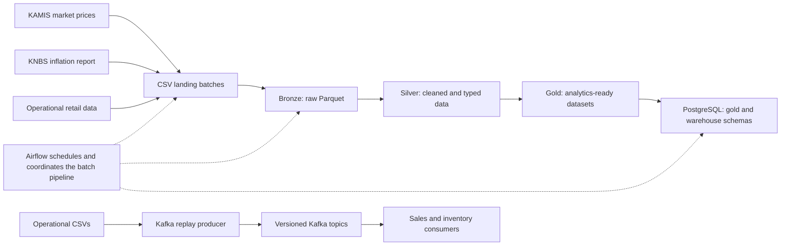

# Kenya Retail Data Platform

This project brings together retail data from three sources: market prices
from KAMIS, inflation reports from KNBS, and operational data such as sales and
inventory. It turns those inputs into datasets for analysis and loads them
into PostgreSQL.

## How it works



The scheduled Airflow pipeline downloads KAMIS prices, gets the latest KNBS
report, and builds an operational snapshot. Each source is saved as a
timestamped CSV batch in `data/landing/`. Spark then creates three Parquet
layers: bronze keeps the source data, silver cleans and types it, and gold
provides datasets ready for reporting and analysis.

Before publishing, the pipeline records data-quality checks, then refreshes
the PostgreSQL tables. Quality issues are reported as warnings; failures in
ingestion, Spark, or PostgreSQL stop the run.

The `gold` schema holds the published datasets. The `warehouse` schema holds
the dimensions and facts used for more detailed analysis.

There is also a small Kafka demo. It replays operational CSV data to versioned
topics, where separate consumers process sales and inventory events. This is
an independent local workflow, not part of the scheduled batch pipeline; its
consumer state is not persisted between runs.

## Example landing batches

Raw batches are written under `data/landing/<source>/<timestamp>/`.

| Source | Batch folder | Date range | Rows |
| --- | --- | --- | ---: |
| KAMIS | [`data/landing/kamis/2026-10-29_064850/`](data/landing/kamis/2026-10-29_064850/) | 2026-10-27 to 2026-10-28 | 692 |
| KNBS CPI | [`data/landing/knbs_pdf/2026-10-26_122403/`](data/landing/knbs_pdf/2026-10-26_122403/) | 2026-09 | 14 |
| Operational | [`data/landing/operational/2026-10-29_064112/`](data/landing/operational/2026-10-29_064112/) | 2025-04-01 to 2026-10-29 | 6 CSV tables |

The KAMIS and KNBS folders each contain a CSV and `manifest.json`. For example,
the [KAMIS manifest](data/landing/kamis/2026-10-29_064850/manifest.json)
records `source: kamis`, `rows: 692`, the date range above, and
`file: kamis_prices.csv`. Its [CSV data](data/landing/kamis/2026-10-29_064850/kamis_prices.csv)
starts with this header and a sample row:

```csv
market,commodity,classification,grade,sex,wholesale_price,retail_price,unit,supply_volume,county,survey_date,source
Vanga,Octopus (Pweza),Fresh,-,-,500.0,700.0,Kg,69.0,Kwale,2026-10-27,KAMIS
```

The [operational batch](data/landing/operational/2026-10-29_064112/) has one
manifest and six CSVs:
`store_master.csv` (6 rows), `product_master.csv` (12), `supplier_master.csv`
(5), `pos_transactions.csv` (22,550), `pos_transaction_lines.csv` (56,512),
and `inventory_movements.csv` (33,314).

## Where to look

- [`sources/`](sources/) contains the KAMIS, KNBS, and operational ingestors.
- [`dags/`](dags/) contains the Airflow pipeline and
  [its documentation](dags/README.md).
- [`spark/`](spark/) contains the transformations, quality checks, and
  PostgreSQL loader. See the [Spark documentation](spark/README.md).
- [`streaming/`](streaming/) contains the Kafka producer and consumers. See
  the [streaming documentation](streaming/README.md).
- [`data/`](data/) holds landed source batches, generated datasets, and
  quality reports.

For instructions on running the project with Docker, see [DOCKER.md](DOCKER.md).
