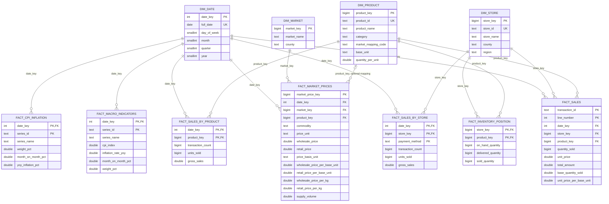

# PostgreSQL warehouse model

The dimensional model lives in the PostgreSQL `warehouse` schema. The original
`gold` schema remains intact. Dimensions provide descriptive context and
surrogate keys; fact tables store measurable events and reference those keys.

## Entity-relationship diagram



`fact_sales` is at POS transaction-line grain. It retains the original package
quantity and price and adds the quantity and price normalized to the product's
base unit (`kg`, `l`, or `each`). Product package conversions are explicit in
the warehouse model. `fact_market_prices` retains the source KAMIS unit and
reported prices, and additionally normalizes kilogram and litre reports to
`price_basis_unit` and the corresponding per-base-unit price measures. The
legacy per-kilogram measures remain populated for kilogram reports.
`fact_macro_indicators` is at series/month grain.
KNBS data currently contains inflation and weighting values, but not a CPI
index; therefore `cpi_index` is null until a source for the index is added.

`dim_product.market_mapping_code` is populated only for explicit commodity
equivalences (Maize Flour, Rice, Wheat Flour, Tomatoes, and Sugar). A mapping
may have no recent KAMIS observation; the query reports that rather than
inventing a price. Other mappings remain null rather than guessing
equivalence. `fact_market_prices.product_key` remains nullable; the
competitiveness query joins through the explicit mapping. A comparison is made
only when both the normalized product base unit and KAMIS price basis are the
same.

## DDL

The following PostgreSQL DDL describes the dimension and fact tables produced
by `spark/warehouse_model.py`. The loader uses `CREATE TABLE IF NOT EXISTS` and
repopulates the facts in its transaction.

```sql
CREATE SCHEMA IF NOT EXISTS warehouse;

CREATE TABLE IF NOT EXISTS warehouse.dim_date (
    date_key INTEGER PRIMARY KEY,
    full_date DATE NOT NULL UNIQUE,
    day_of_week SMALLINT NOT NULL,
    month SMALLINT NOT NULL,
    quarter SMALLINT NOT NULL,
    year SMALLINT NOT NULL
);

CREATE TABLE IF NOT EXISTS warehouse.dim_store (
    store_key BIGINT GENERATED BY DEFAULT AS IDENTITY PRIMARY KEY,
    store_id TEXT NOT NULL UNIQUE,
    store_name TEXT,
    county TEXT,
    region TEXT NOT NULL
);

CREATE TABLE IF NOT EXISTS warehouse.dim_product (
    product_key BIGINT GENERATED BY DEFAULT AS IDENTITY PRIMARY KEY,
    product_id TEXT NOT NULL UNIQUE,
    product_name TEXT,
    category TEXT,
    market_mapping_code TEXT,
    base_unit TEXT,
    quantity_per_unit DOUBLE PRECISION
);

CREATE TABLE IF NOT EXISTS warehouse.dim_market (
    market_key BIGINT GENERATED BY DEFAULT AS IDENTITY PRIMARY KEY,
    market_name TEXT NOT NULL,
    county TEXT NOT NULL,
    UNIQUE (market_name, county)
);

CREATE TABLE IF NOT EXISTS warehouse.fact_sales (
    transaction_id TEXT NOT NULL,
    line_number INTEGER NOT NULL,
    date_key INTEGER NOT NULL REFERENCES warehouse.dim_date(date_key),
    store_key BIGINT NOT NULL REFERENCES warehouse.dim_store(store_key),
    product_key BIGINT NOT NULL REFERENCES warehouse.dim_product(product_key),
    quantity_sold BIGINT NOT NULL,
    unit_price DOUBLE PRECISION NOT NULL,
    total_amount DOUBLE PRECISION NOT NULL,
    base_quantity_sold DOUBLE PRECISION NOT NULL,
    unit_price_per_base_unit DOUBLE PRECISION NOT NULL,
    PRIMARY KEY (transaction_id, line_number)
);

CREATE TABLE IF NOT EXISTS warehouse.fact_market_prices (
    market_price_key BIGINT GENERATED BY DEFAULT AS IDENTITY PRIMARY KEY,
    date_key INTEGER NOT NULL REFERENCES warehouse.dim_date(date_key),
    market_key BIGINT NOT NULL REFERENCES warehouse.dim_market(market_key),
    product_key BIGINT REFERENCES warehouse.dim_product(product_key),
    commodity TEXT NOT NULL,
    classification TEXT,
    grade TEXT,
    sex TEXT,
    price_unit TEXT,
    wholesale_price DOUBLE PRECISION,
    retail_price DOUBLE PRECISION,
    price_basis_unit TEXT,
    wholesale_price_per_base_unit DOUBLE PRECISION,
    retail_price_per_base_unit DOUBLE PRECISION,
    wholesale_price_per_kg DOUBLE PRECISION,
    retail_price_per_kg DOUBLE PRECISION,
    supply_volume DOUBLE PRECISION
);

CREATE UNIQUE INDEX IF NOT EXISTS uq_fact_market_prices_grain
ON warehouse.fact_market_prices (
    date_key,
    market_key,
    commodity,
    COALESCE(classification, ''),
    COALESCE(grade, ''),
    COALESCE(sex, ''),
    COALESCE(price_unit, '')
);

CREATE TABLE IF NOT EXISTS warehouse.fact_macro_indicators (
    date_key INTEGER NOT NULL REFERENCES warehouse.dim_date(date_key),
    series_id TEXT NOT NULL,
    series_name TEXT,
    cpi_index DOUBLE PRECISION, -- NULL: KNBS provides inflation/weights, not index values.
    inflation_rate_yoy DOUBLE PRECISION,
    month_on_month_pct DOUBLE PRECISION,
    weight_pct DOUBLE PRECISION,
    PRIMARY KEY (date_key, series_id)
);

CREATE TABLE IF NOT EXISTS warehouse.fact_cpi_inflation (
    date_key INTEGER NOT NULL REFERENCES warehouse.dim_date(date_key),
    series_id TEXT NOT NULL,
    series_name TEXT,
    weight_pct DOUBLE PRECISION,
    month_on_month_pct DOUBLE PRECISION,
    yoy_inflation_pct DOUBLE PRECISION,
    PRIMARY KEY (date_key, series_id)
);

CREATE TABLE IF NOT EXISTS warehouse.fact_sales_by_store (
    date_key INTEGER NOT NULL REFERENCES warehouse.dim_date(date_key),
    store_key BIGINT NOT NULL REFERENCES warehouse.dim_store(store_key),
    payment_method TEXT NOT NULL,
    transaction_count BIGINT NOT NULL,
    units_sold BIGINT NOT NULL,
    gross_sales DOUBLE PRECISION NOT NULL,
    PRIMARY KEY (date_key, store_key, payment_method)
);

CREATE TABLE IF NOT EXISTS warehouse.fact_sales_by_product (
    date_key INTEGER NOT NULL REFERENCES warehouse.dim_date(date_key),
    product_key BIGINT NOT NULL REFERENCES warehouse.dim_product(product_key),
    transaction_count BIGINT NOT NULL,
    units_sold BIGINT NOT NULL,
    gross_sales DOUBLE PRECISION NOT NULL,
    PRIMARY KEY (date_key, product_key)
);

CREATE TABLE IF NOT EXISTS warehouse.fact_inventory_position (
    store_key BIGINT NOT NULL REFERENCES warehouse.dim_store(store_key),
    product_key BIGINT NOT NULL REFERENCES warehouse.dim_product(product_key),
    on_hand_quantity BIGINT NOT NULL,
    delivered_quantity BIGINT NOT NULL,
    sold_quantity BIGINT NOT NULL,
    PRIMARY KEY (store_key, product_key)
);
```

## Grain and measure notes

| Table | Grain |
|---|---|
| `dim_date` | One calendar day |
| `dim_store` | One retail store |
| `dim_product` | One retail product |
| `dim_market` | One KAMIS market and county |
| `fact_sales` | One POS transaction line |
| `fact_market_prices` | One commodity, market, survey date, and reported classification/unit |
| `fact_macro_indicators` | One KNBS series and month |
| `fact_sales_by_store` | One date, store, and payment method |
| `fact_sales_by_product` | One date and product |
| `fact_inventory_position` | One store and product |
| `fact_cpi_inflation` | One CPI series and month |

`fact_sales_by_store` and `fact_sales_by_product` are pre-aggregated reporting
tables. Use `fact_sales` for transaction-line analyses and do not add the
aggregate sales facts to `fact_sales` in the same measure calculation, as that
would double-count revenue.

## Example analytical query results

These results were captured on 2026-11-08 by running all five read-only
queries in [warehouse_queries.sql](warehouse_queries.sql) against the local
PostgreSQL warehouse. Currency and price values below are rounded to two
decimal places for readability. The operational POS data is synthetic.

### 1. Regional sales performance

All five result rows:

| Region | County | Transactions | Revenue |
|---|---|---:|---:|
| Nairobi | Nairobi | 7,545 | 5,340,735.12 |
| Coast | Mombasa | 3,802 | 2,672,905.72 |
| Nyanza | Kisumu | 3,738 | 2,648,049.01 |
| Rift Valley | Nakuru | 3,788 | 2,639,521.43 |
| Rift Valley | Uasin Gishu | 3,677 | 2,626,651.97 |

Nairobi leads the sample in transaction-line revenue, while the other counties
are comparatively close; an analyst can use this to prioritize regional
follow-up.

### 2. Supermarket price competitiveness

All 12 products are returned; this excerpt shows the comparison fields:

| Product | Basis | Supermarket | KAMIS | Survey date | Premium | Result |
|---|---|---:|---:|---|---:|---|
| Bar Soap | each | 209.87 | — | — | — | Needs verified commodity mapping |
| Bread 400g | kg | 150.21 | — | — | — | Needs verified commodity mapping |
| Cooking Fat 1kg | kg | 160.11 | — | — | — | Needs verified commodity mapping |
| Cooking Oil 1L | l | 280.31 | — | — | — | Needs verified commodity mapping |
| Fresh Milk 1L | l | 54.95 | — | — | — | Needs verified commodity mapping |
| Maize Flour 2kg | kg | 48.02 | 111.25 | 2026-10-25 | -56.84% | Supermarket below KAMIS |
| Onions 1kg | kg | 85.14 | — | — | — | Needs verified commodity mapping |
| Rice 1kg | kg | 190.19 | 171.43 | 2026-10-28 | 10.95% | Supermarket above KAMIS |
| Sugar 1kg | kg | 155.02 | — | — | — | No latest comparable KAMIS price |
| Tea Leaves 500g | kg | 479.50 | — | — | — | Needs verified commodity mapping |
| Tomatoes 1kg | kg | 94.88 | 83.33 | 2026-10-28 | 13.85% | Supermarket above KAMIS |
| Wheat Flour 1kg | kg | 62.03 | 92.50 | 2026-10-25 | -32.94% | Supermarket below KAMIS |

The comparison highlights where mapped supermarket prices are above or below
the latest available KAMIS survey, while keeping unmapped or unavailable
comparisons explicit rather than implying equivalence.

### 3. Daily sales trend by store

The query returns 3,462 rows; the first eight, ordered by latest date and
revenue:

| Date | Store | County | Revenue | Units | Transactions |
|---|---|---|---:|---:|---:|
| 2026-10-29 | Eldoret Plaza | Uasin Gishu | 4,822.63 | 31 | 7 |
| 2026-10-29 | Mombasa Town | Mombasa | 4,546.20 | 30 | 6 |
| 2026-10-29 | Kisumu Main | Kisumu | 4,432.50 | 29 | 5 |
| 2026-10-29 | Nairobi CBD | Nairobi | 2,355.70 | 24 | 6 |
| 2026-10-29 | Nakuru Centre | Nakuru | 2,142.75 | 17 | 5 |
| 2026-10-29 | Nairobi West | Nairobi | 1,727.85 | 13 | 4 |
| 2026-10-28 | Eldoret Plaza | Uasin Gishu | 4,623.09 | 31 | 7 |
| 2026-10-28 | Nakuru Centre | Nakuru | 4,190.54 | 37 | 7 |

This daily view helps analysts compare store performance and spot changes in
sales, units, and transaction volume over time.

### 4. Monthly KNBS inflation by division

All 14 results are for September 2026; `cpi_index` is `NULL` in every row:

| Series | Year-over-year inflation | Month-over-month change | Weight |
|---|---:|---:|---:|
| CPI_02 Alcoholic Beverages, Tobacco and Narcotics | 2.8% | 0.4% | 3.3289% |
| CPI_ALL_ITEMS | 6.8% | 0.4% | 100.0000% |
| CPI_03 Clothing and Footwear | 2.2% | 0.1% | 2.9914% |
| CPI_10 Education Services | 3.0% | 0.1% | 5.5620% |
| CPI_01 Food and Non-Alcoholic Beverages | 9.5% | 0.9% | 32.9094% |
| CPI_05 Furnishings, Household Equipment and Routine Household Maintenance | 3.1% | 0.2% | 3.7372% |
| CPI_06 Health | 2.8% | 0.1% | 2.9116% |
| CPI_04 Housing, Water, Electricity, Gas and Other Fuels | 3.2% | 0.1% | 14.6124% |
| CPI_08 Information and Communication | 0.8% | 0.1% | 7.7840% |
| CPI_12 Insurance and Financial Services | 1.1% | 0.0% | 2.2423% |
| CPI_13 Personal Care, Social Protection and Miscellaneous Goods and Services | 2.5% | 0.2% | 4.4532% |
| CPI_09 Recreation, Sport and Culture | 3.5% | 0.1% | 1.7219% |
| CPI_11 Restaurants and Accommodation Services | 3.0% | 0.1% | 8.0991% |
| CPI_07 Transport | 15.6% | -0.4% | 9.6468% |

Food inflation is above the all-items rate in this report, which can inform
retail pricing context; the absent index level means these results cannot be
used to deflate nominal sales or prices.

### 5. Inventory position by store and product

The query returns 72 rows; these are the 12 products for Eldoret Plaza:

| Product | Category | On hand | Delivered | Sold |
|---|---|---:|---:|---:|
| Bar Soap | Household | -329 | 1,200 | 1,561 |
| Bread 400g | Cereals & Grains | -49 | 1,368 | 1,493 |
| Cooking Fat 1kg | Cooking Fats & Oils | -523 | 951 | 1,504 |
| Cooking Oil 1L | Cooking Fats & Oils | -105 | 1,436 | 1,617 |
| Fresh Milk 1L | Dairy | -414 | 1,090 | 1,563 |
| Maize Flour 2kg | Cereals & Grains | -366 | 1,100 | 1,537 |
| Onions 1kg | Fresh Produce | -286 | 1,103 | 1,458 |
| Rice 1kg | Cereals & Grains | 232 | 1,741 | 1,552 |
| Sugar 1kg | Sugar & Tea | -136 | 1,368 | 1,535 |
| Tea Leaves 500g | Sugar & Tea | -321 | 1,213 | 1,606 |
| Tomatoes 1kg | Fresh Produce | -133 | 1,289 | 1,491 |
| Wheat Flour 1kg | Cereals & Grains | -404 | 1,158 | 1,590 |

Negative on-hand balances in this synthetic movement data are a useful
reconciliation/restock signal, not proof of real-world stock-outs.
