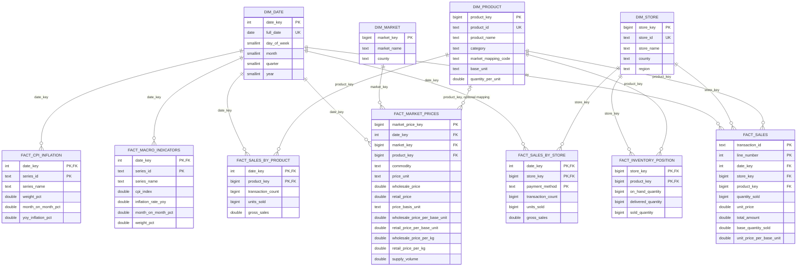

# PostgreSQL warehouse model

The dimensional model lives in the PostgreSQL `warehouse` schema. The original
`gold` schema remains intact. Dimensions provide descriptive context and
surrogate keys; fact tables store measurable events and reference those keys.

## Entity-relationship diagram



`fact_sales` is at POS transaction-line grain. It retains the original package
quantity and price and adds the quantity and price normalized to the product's
base unit (`kg`, `l`, or `each`). Product package conversions are explicit in
the warehouse model. `fact_market_prices` retains the source KAMIS unit and
reported prices, and additionally normalizes kilogram and litre reports to
`price_basis_unit` and the corresponding per-base-unit price measures. The
legacy per-kilogram measures remain populated for kilogram reports.
`fact_macro_indicators` is at series/month grain.
KNBS data currently contains inflation and weighting values, but not a CPI
index; therefore `cpi_index` is null until a source for the index is added.

`dim_product.market_mapping_code` is populated only for explicit commodity
equivalences (Maize Flour, Rice, Wheat Flour, Tomatoes, and Sugar). A mapping
may have no recent KAMIS observation; the query reports that rather than
inventing a price. Other mappings remain null rather than guessing
equivalence. `fact_market_prices.product_key` remains nullable; the
competitiveness query joins through the explicit mapping. A comparison is made
only when both the normalized product base unit and KAMIS price basis are the
same.

## DDL

The following PostgreSQL DDL describes the dimension and fact tables produced
by `spark/warehouse_model.py`. The loader uses `CREATE TABLE IF NOT EXISTS` and
repopulates the facts in its transaction.

```sql
CREATE SCHEMA IF NOT EXISTS warehouse;

CREATE TABLE IF NOT EXISTS warehouse.dim_date (
    date_key INTEGER PRIMARY KEY,
    full_date DATE NOT NULL UNIQUE,
    day_of_week SMALLINT NOT NULL,
    month SMALLINT NOT NULL,
    quarter SMALLINT NOT NULL,
    year SMALLINT NOT NULL
);

CREATE TABLE IF NOT EXISTS warehouse.dim_store (
    store_key BIGINT GENERATED BY DEFAULT AS IDENTITY PRIMARY KEY,
    store_id TEXT NOT NULL UNIQUE,
    store_name TEXT,
    county TEXT,
    region TEXT NOT NULL
);

CREATE TABLE IF NOT EXISTS warehouse.dim_product (
    product_key BIGINT GENERATED BY DEFAULT AS IDENTITY PRIMARY KEY,
    product_id TEXT NOT NULL UNIQUE,
    product_name TEXT,
    category TEXT,
    market_mapping_code TEXT,
    base_unit TEXT,
    quantity_per_unit DOUBLE PRECISION
);

CREATE TABLE IF NOT EXISTS warehouse.dim_market (
    market_key BIGINT GENERATED BY DEFAULT AS IDENTITY PRIMARY KEY,
    market_name TEXT NOT NULL,
    county TEXT NOT NULL,
    UNIQUE (market_name, county)
);

CREATE TABLE IF NOT EXISTS warehouse.fact_sales (
    transaction_id TEXT NOT NULL,
    line_number INTEGER NOT NULL,
    date_key INTEGER NOT NULL REFERENCES warehouse.dim_date(date_key),
    store_key BIGINT NOT NULL REFERENCES warehouse.dim_store(store_key),
    product_key BIGINT NOT NULL REFERENCES warehouse.dim_product(product_key),
    quantity_sold BIGINT NOT NULL,
    unit_price DOUBLE PRECISION NOT NULL,
    total_amount DOUBLE PRECISION NOT NULL,
    base_quantity_sold DOUBLE PRECISION NOT NULL,
    unit_price_per_base_unit DOUBLE PRECISION NOT NULL,
    PRIMARY KEY (transaction_id, line_number)
);

CREATE TABLE IF NOT EXISTS warehouse.fact_market_prices (
    market_price_key BIGINT GENERATED BY DEFAULT AS IDENTITY PRIMARY KEY,
    date_key INTEGER NOT NULL REFERENCES warehouse.dim_date(date_key),
    market_key BIGINT NOT NULL REFERENCES warehouse.dim_market(market_key),
    product_key BIGINT REFERENCES warehouse.dim_product(product_key),
    commodity TEXT NOT NULL,
    classification TEXT,
    grade TEXT,
    sex TEXT,
    price_unit TEXT,
    wholesale_price DOUBLE PRECISION,
    retail_price DOUBLE PRECISION,
    price_basis_unit TEXT,
    wholesale_price_per_base_unit DOUBLE PRECISION,
    retail_price_per_base_unit DOUBLE PRECISION,
    wholesale_price_per_kg DOUBLE PRECISION,
    retail_price_per_kg DOUBLE PRECISION,
    supply_volume DOUBLE PRECISION
);

CREATE UNIQUE INDEX IF NOT EXISTS uq_fact_market_prices_grain
ON warehouse.fact_market_prices (
    date_key,
    market_key,
    commodity,
    COALESCE(classification, ''),
    COALESCE(grade, ''),
    COALESCE(sex, ''),
    COALESCE(price_unit, '')
);

CREATE TABLE IF NOT EXISTS warehouse.fact_macro_indicators (
    date_key INTEGER NOT NULL REFERENCES warehouse.dim_date(date_key),
    series_id TEXT NOT NULL,
    series_name TEXT,
    cpi_index DOUBLE PRECISION,
    inflation_rate_yoy DOUBLE PRECISION,
    month_on_month_pct DOUBLE PRECISION,
    weight_pct DOUBLE PRECISION,
    PRIMARY KEY (date_key, series_id)
);

CREATE TABLE IF NOT EXISTS warehouse.fact_cpi_inflation (
    date_key INTEGER NOT NULL REFERENCES warehouse.dim_date(date_key),
    series_id TEXT NOT NULL,
    series_name TEXT,
    weight_pct DOUBLE PRECISION,
    month_on_month_pct DOUBLE PRECISION,
    yoy_inflation_pct DOUBLE PRECISION,
    PRIMARY KEY (date_key, series_id)
);

CREATE TABLE IF NOT EXISTS warehouse.fact_sales_by_store (
    date_key INTEGER NOT NULL REFERENCES warehouse.dim_date(date_key),
    store_key BIGINT NOT NULL REFERENCES warehouse.dim_store(store_key),
    payment_method TEXT NOT NULL,
    transaction_count BIGINT NOT NULL,
    units_sold BIGINT NOT NULL,
    gross_sales DOUBLE PRECISION NOT NULL,
    PRIMARY KEY (date_key, store_key, payment_method)
);

CREATE TABLE IF NOT EXISTS warehouse.fact_sales_by_product (
    date_key INTEGER NOT NULL REFERENCES warehouse.dim_date(date_key),
    product_key BIGINT NOT NULL REFERENCES warehouse.dim_product(product_key),
    transaction_count BIGINT NOT NULL,
    units_sold BIGINT NOT NULL,
    gross_sales DOUBLE PRECISION NOT NULL,
    PRIMARY KEY (date_key, product_key)
);

CREATE TABLE IF NOT EXISTS warehouse.fact_inventory_position (
    store_key BIGINT NOT NULL REFERENCES warehouse.dim_store(store_key),
    product_key BIGINT NOT NULL REFERENCES warehouse.dim_product(product_key),
    on_hand_quantity BIGINT NOT NULL,
    delivered_quantity BIGINT NOT NULL,
    sold_quantity BIGINT NOT NULL,
    PRIMARY KEY (store_key, product_key)
);
```

## Grain and measure notes

| Table | Grain |
|---|---|
| `dim_date` | One calendar day |
| `dim_store` | One retail store |
| `dim_product` | One retail product |
| `dim_market` | One KAMIS market and county |
| `fact_sales` | One POS transaction line |
| `fact_market_prices` | One commodity, market, survey date, and reported classification/unit |
| `fact_macro_indicators` | One KNBS series and month |
| `fact_sales_by_store` | One date, store, and payment method |
| `fact_sales_by_product` | One date and product |
| `fact_inventory_position` | One store and product |
| `fact_cpi_inflation` | One CPI series and month |

`fact_sales_by_store` and `fact_sales_by_product` are pre-aggregated reporting
tables. Use `fact_sales` for transaction-line analyses and do not add the
aggregate sales facts to `fact_sales` in the same measure calculation, as that
would double-count revenue.
